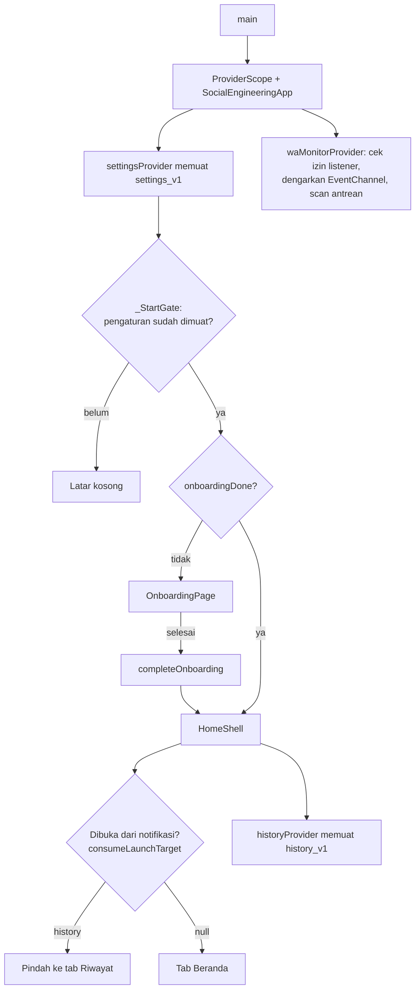
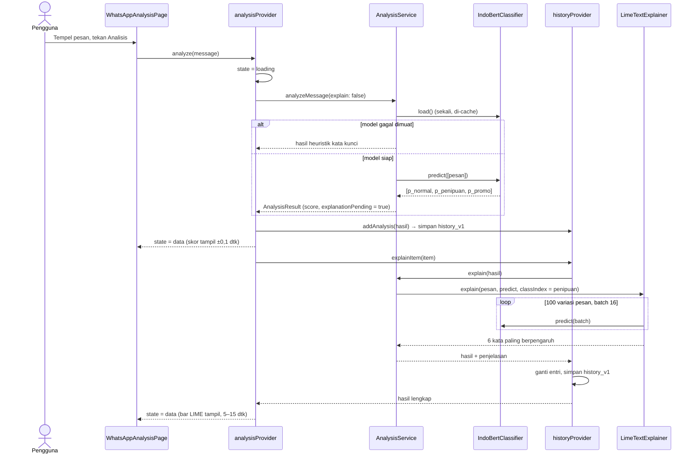
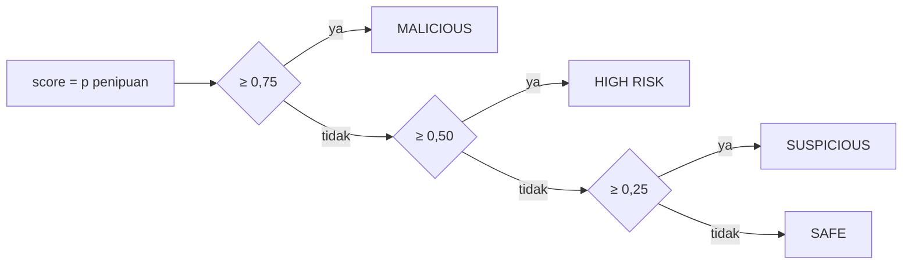
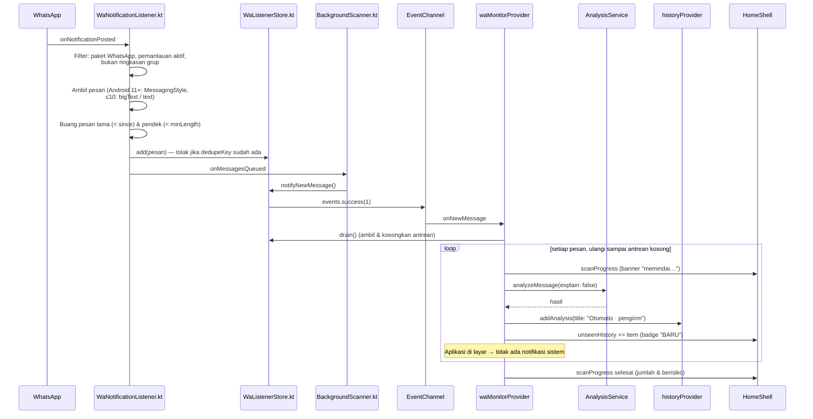
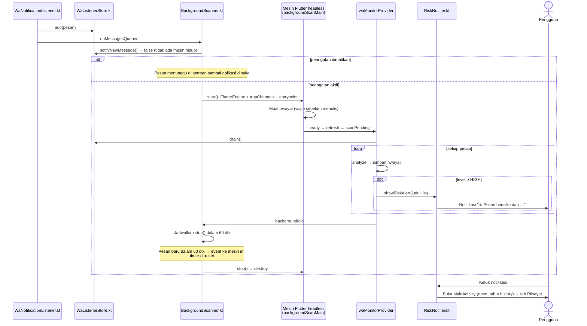
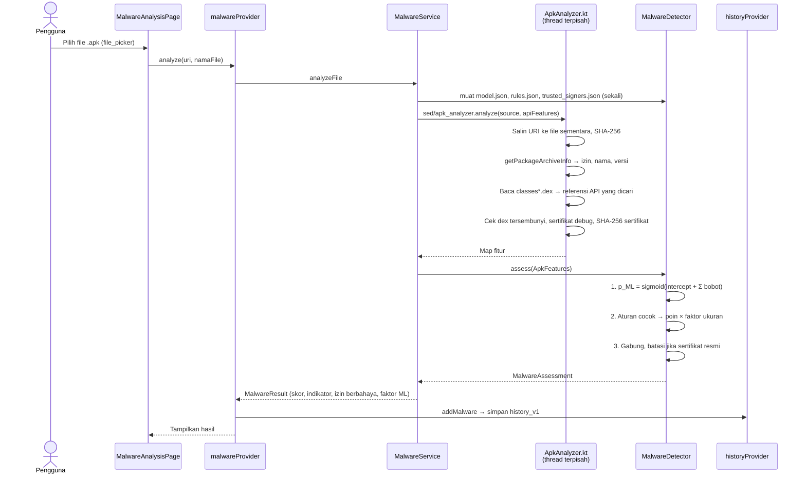
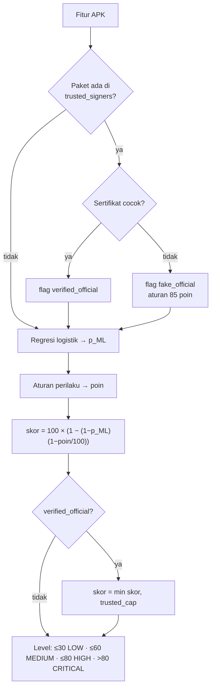
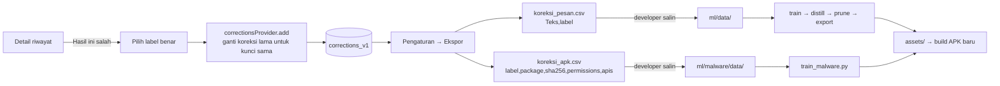
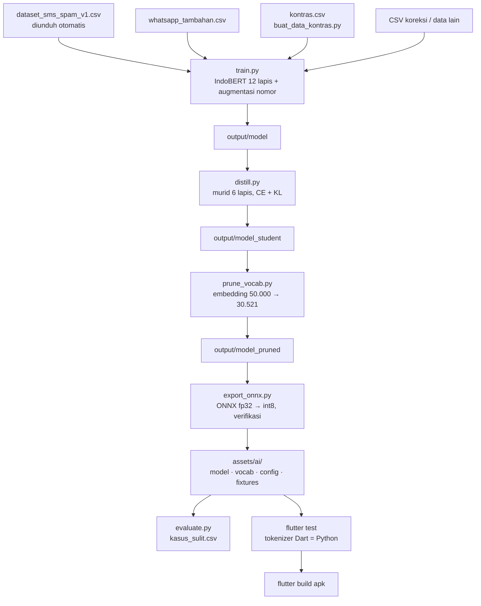

# 05 — Flow Aplikasi

Diagram memakai **Mermaid** dan tampil otomatis di GitHub, GitLab, dan
VS Code (dengan ekstensi *Markdown Preview Mermaid Support*).

Daftar flow:

1. [Startup aplikasi](#1-startup-aplikasi)
2. [Analisis pesan manual (dua tahap)](#2-analisis-pesan-manual-dua-tahap)
3. [Scan otomatis WhatsApp — aplikasi terbuka](#3-scan-otomatis-whatsapp--aplikasi-terbuka)
4. [Scan otomatis WhatsApp — aplikasi tertutup](#4-scan-otomatis-whatsapp--aplikasi-tertutup)
5. [Analisis APK](#5-analisis-apk)
6. [Koreksi pengguna → latih ulang](#6-koreksi-pengguna--latih-ulang)
7. [Pipeline model AI (developer)](#7-pipeline-model-ai-developer)

---

## 1. Startup aplikasi

Catatan:
- `_StartGate` menunggu pengaturan termuat agar pengguna lama tidak melihat
  onboarding berkedip sesaat.
- Riwayat baru ditulis setelah riwayat lama selesai dimuat (`loaded`), agar
  tidak saling menimpa.

---

## 2. Analisis pesan manual (dua tahap)

Tahap 1 dan 2 dipisah karena LIME butuh ±100 inferensi. Jika pengguna sudah
menganalisis pesan lain sebelum LIME selesai, hasil lama tidak menimpa layar.

### Penentuan level

---

## 3. Scan otomatis WhatsApp — aplikasi terbuka

LIME untuk pesan otomatis **tidak** dihitung saat scan. LIME dihitung ketika
pengguna membuka detail entri (`historyProvider.explainItem`).

---

## 4. Scan otomatis WhatsApp — aplikasi tertutup

Mesin headless menjalankan **kode Dart yang sama** dengan aplikasi, sehingga
tidak ada logika analisis ganda di Kotlin.

---

## 5. Analisis APK

---

## 6. Koreksi pengguna → latih ulang

---

## 7. Pipeline model AI (developer)

Prinsip penting:
- `ml/eval/kasus_sulit.csv` tidak pernah dipakai untuk melatih (dibuang
  otomatis jika bocor ke data latih).
- Setiap ekspor membuat nama file model baru (hash) dan fixture baru.
