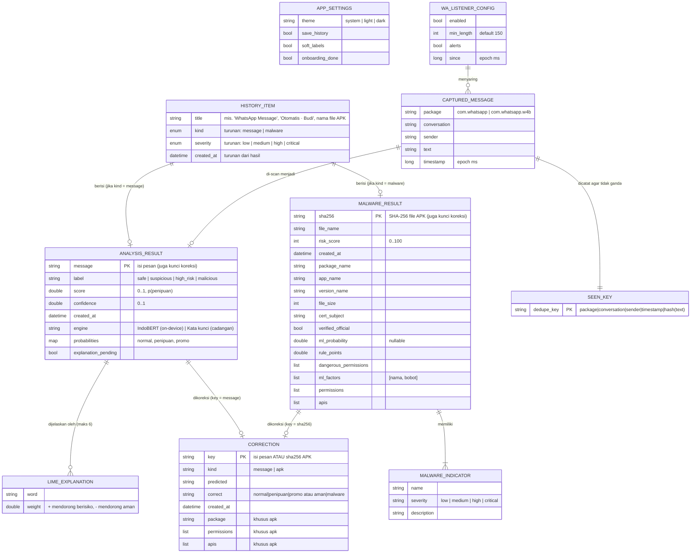

# 06 — ERD & Model Data

## 1. Penting: tidak ada database relasional

Aplikasi ini **tidak** memakai SQLite atau server. Semua data disimpan di
**SharedPreferences** HP sebagai string JSON, dengan dua "ruang" terpisah:

| Ruang | Ditulis oleh | Isi |
|---|---|---|
| SharedPreferences Flutter (`FlutterSharedPreferences`) | Dart (`LocalStore`) | `settings_v1`, `history_v1`, `corrections_v1` |
| SharedPreferences native `wa_listener` | Kotlin (`WaListenerStore`) | Antrean pesan WhatsApp, kunci dedup, konfigurasi listener |

ERD di bawah adalah **model data logis**: entitas dan relasinya. Relasi
diwujudkan dengan **penyematan (embedding)** JSON, bukan foreign key, kecuali
relasi koreksi yang memakai kunci alami (isi pesan / SHA-256 APK).

---

## 2. ERD



### Kardinalitas & aturan

| Relasi | Aturan |
|---|---|
| `HISTORY_ITEM` → hasil | Tepat **satu** dari `analysis` atau `malware` terisi |
| `ANALYSIS_RESULT` → `LIME_EXPLANATION` | 0 saat `explanation_pending = true`; maks 6 setelah dihitung |
| `MALWARE_RESULT` → `MALWARE_INDICATOR` | Minimal 1 (indikator model ML selalu ada) |
| `CORRECTION` | **Satu** koreksi per kunci; koreksi baru menggantikan yang lama |
| `CAPTURED_MESSAGE` | Antrean sementara — dihapus saat `drain()`, lalu menjadi `HISTORY_ITEM` berjudul `Otomatis · <pengirim>` |
| `APP_SETTINGS`, `WA_LISTENER_CONFIG` | Singleton (satu objek) |

### Atribut turunan (tidak disimpan)

`HISTORY_ITEM` hanya menyimpan `title` + hasil. `kind`, `subtitle`,
`severity`, dan `created_at` dihitung ulang saat dimuat:

| `ANALYSIS_RESULT.label` | `severity` |
|---|---|
| `safe` | `low` |
| `suspicious` | `medium` |
| `high_risk` | `high` |
| `malicious` | `critical` |

`MALWARE_RESULT` → `severity`: skor ≤30 `low`, ≤60 `medium`, ≤80 `high`,
>80 `critical`.

---

## 3. Skema fisik per kunci

### `settings_v1` — objek

```json
{
  "theme": "system",
  "save_history": true,
  "soft_labels": true,
  "onboarding_done": true
}
```

Kunci tidak dikenal / rusak → nilai default (`AppSettings.fromJson`).

### `history_v1` — array, terbaru di depan, maks 300

```json
[
  {
    "title": "Otomatis · Budi @ Grup Keluarga",
    "analysis": {
      "message": "Selamat! Anda memenangkan hadiah ...",
      "label": "malicious",
      "score": 0.93,
      "confidence": 0.93,
      "explanation": [
        { "word": "hadiah", "weight": 0.21 },
        { "word": "klik",   "weight": 0.14 }
      ],
      "created_at": "2026-10-29T09:12:44.120",
      "engine": "IndoBERT (on-device)",
      "probabilities": { "normal": 0.04, "penipuan": 0.93, "promo": 0.03 },
      "explanation_pending": false
    }
  },
  {
    "title": "undangan.apk",
    "malware": {
      "file_name": "undangan.apk",
      "sha256": "9f2c…",
      "risk_score": 87,
      "indicators": [
        { "name": "Pola pencuri SMS/OTP", "severity": "critical", "description": "…" },
        { "name": "Model ML: 12.0% mirip malware", "severity": "low", "description": "…" }
      ],
      "created_at": "2026-10-29T09:20:01.000",
      "package_name": "com.undangan.app",
      "app_name": "Undangan",
      "version_name": "1.0",
      "file_size": 2481152,
      "cert_subject": "CN=Android Debug,O=Android,C=US",
      "verified_official": false,
      "ml_probability": 0.12,
      "rule_points": 85.0,
      "dangerous_permissions": ["READ_SMS", "RECEIVE_SMS"],
      "ml_factors": [["RECEIVE_SMS", 1.42], ["READ_SMS", 0.97]],
      "permissions": ["INTERNET", "READ_SMS", "RECEIVE_SMS"],
      "apis": ["Landroid/telephony/SmsManager;->sendTextMessage"]
    }
  }
]
```

- Tidak ditulis sama sekali jika `save_history = false`; mematikan sakelar
  menghapus kunci ini.
- Kebijakan retensi: `applyRetention` memotong ke 300 entri terbaru.

### `corrections_v1` — array

```json
[
  {
    "kind": "message",
    "key": "Pak, file laporan sudah saya kirim ya.",
    "predicted": "penipuan",
    "correct": "normal",
    "created_at": "2026-10-29T10:01:00.000"
  },
  {
    "kind": "apk",
    "key": "9f2c…",
    "predicted": "malware",
    "correct": "aman",
    "created_at": "2026-10-29T10:05:00.000",
    "package": "com.contoh.app",
    "permissions": ["INTERNET", "CAMERA"],
    "apis": []
  }
]
```

### SharedPreferences native `wa_listener`

| Kunci | Tipe | Isi |
|---|---|---|
| `enabled` | bool | Pemantauan aktif (default `true`) |
| `min_length` | int | Panjang minimum pesan (default 150) |
| `alerts` | bool | Scan latar belakang + notifikasi (default `true`) |
| `since` | long | Pesan sebelum waktu ini diabaikan |
| `queue` | string JSON | Array `CAPTURED_MESSAGE`, maks 200 (FIFO, yang tertua dibuang) |
| `seen` | string JSON | Array `dedupe_key`, maks 500 |

```json
// queue
[
  {
    "package": "com.whatsapp",
    "conversation": "Grup Keluarga",
    "sender": "Budi",
    "text": "Ma, ini aku. HP aku rusak …",
    "timestamp": 1761703964120
  }
]
```

---

## 4. Ekspor CSV (data latih)

Koreksi diekspor dari *Pengaturan* ke format yang langsung dibaca skrip ML.

**`koreksi_pesan.csv`** → `ml/data/`

| Kolom | Isi |
|---|---|
| `Teks` | Isi pesan (RFC 4180, dikutip) |
| `label` | 0 normal · 1 penipuan · 2 promo |

**`koreksi_apk.csv`** → `ml/malware/data/`

| Kolom | Isi |
|---|---|
| `label` | 0 aman · 1 malware |
| `package` | Nama paket |
| `sha256` | SHA-256 APK |
| `permissions` | Dipisah `\|` |
| `apis` | Dipisah `\|` (bukan `;` karena nama API memuat `;`) |

---

## 5. Data statis (aset, read-only)

Bukan data pengguna, tetapi menjadi "tabel referensi" bagi mesin analisis.

| Aset | Struktur |
|---|---|
| `assets/ai/config.json` | `model_file`, `base_model`, `labels[]`, `risk_label`, `max_len`, `do_lower_case` |
| `assets/ai/vocab.txt` | Satu token per baris; nomor baris (mulai 0) = id token |
| `assets/malware/model.json` | `intercept`, `threshold`, `features[] {name, type: permission\|api, weight}`, metrik |
| `assets/malware/rules.json` | `rules[] {id, title, severity, points, scaled, any_permissions, min_matches, all_permissions, any_apis, flags, max_permissions}`, `scaling`, `trusted_cap` |
| `assets/malware/trusted_signers.json` | `signers { package: [sha256 sertifikat] }` |

---

## 6. Migrasi format

Setiap kunci memakai akhiran versi (`_v1`). Jika format JSON berubah secara
tidak kompatibel:

1. Pakai kunci baru (`history_v2`).
2. Saat memuat, baca `_v2`; jika kosong, baca `_v1` dan konversi.
3. Hapus `_v1` setelah konversi berhasil.

Penambahan field **opsional** tidak butuh versi baru: semua `fromJson`
memberi nilai default untuk field yang tidak ada.
